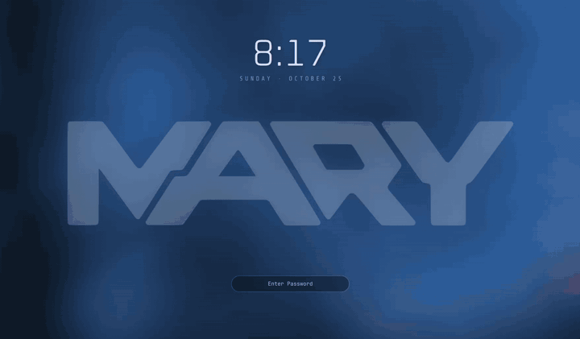
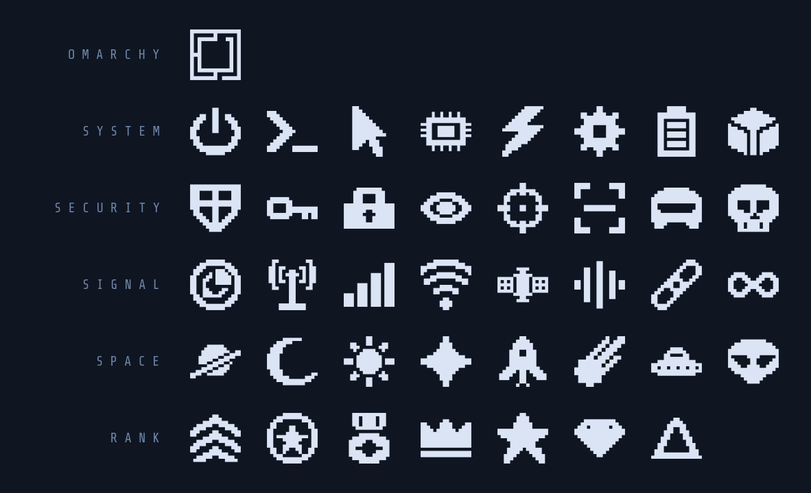
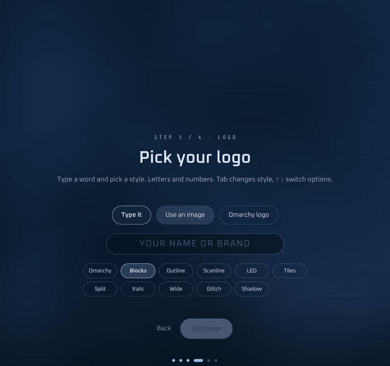
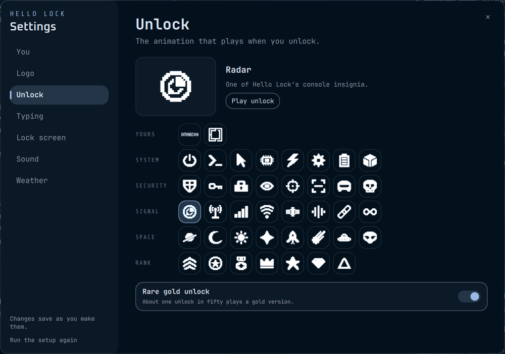
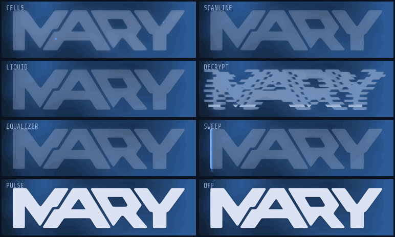

# Hello Lock

A lock screen for [Omarchy](https://omarchy.org) that greets you.

<p align="center">
  <br>
  
</p>

- **Your name and logo** on the lock screen, in your theme's colors.
- **It reacts as you type, your choice of eight ways.** By default the logo starts dim and lights up cell by cell with each character, fully lit at about 12. Pressing Enter fills the rest, so it's fully lit when the unlock takes over, and a wrong password breaks it apart. There are seven more [typing effects](#typing-effects), or *shuffle* for a different one each time you lock. They only follow how many characters you've typed, like the dots do, never what they are.
- **A wrong password is handled calmly.** A short shake and `ACCESS DENIED · ATTEMPT 2` under the field. From the third try, one helpful hint: "Caps Lock is on", or which keyboard layout is active if you have several. A small `⇪ CAPS` badge shows whenever Caps Lock is on.
- **Power-down on lock:** the screen collapses like an old CRT turning off. With several monitors it ripples across them.
- **Power-on unlock:** one of eleven animations (coin, assemble, scan, glitch, heartbeat, orbit, monolith, particles, warp, split, pixels) with a typed status line and a greeting. They're shuffled, so you see all of them before any repeats. In *pixels*, your symbol's pixels rain in and lock into place; it works for any symbol, including your own image. With several monitors, the one you're using gets the full animation and the others a quieter fade.
- **Little touches:** a clock and date, battery and weather after unlocking, holiday and birthday greetings, a "you were away 2h 14m" line, low warm sounds, and a rare gold *legendary* unlock.
- **Calm when you want it:** if you turn Hyprland's animations off, Hello Lock switches to gentle fades too (see `motion`).

You don't need to bring anything. Without a config it uses your account's name and the Omarchy logo.

## Setup

The first time the shell starts with Hello Lock, a short setup screen opens. It looks like the lock screen and asks five things:

1. **Your name**, prefilled from your account.
2. **Your birthday** (optional).
3. **Your logo:**
   - **Type it:** type a word and pick one of eleven styles, drawn live. **Omarchy** uses the very font the Omarchy logo is drawn from (letters only); the other ten use a pixel alphabet made for Hello Lock (letters and numbers).
   - **Use an image:** pick an SVG or PNG with the desktop file chooser. It's copied into `~/.config/hello-lock/`, so moving the original later is fine.
   - **Omarchy logo:** keep the default.
4. **Your unlock symbol**, the image that animates when you unlock:

   

   - **My logo / My name:** the logo from step 3 again. Wide wordmarks get extra room in the animation.
   - **Omarchy:** the Omarchy symbol.
   - **A console insignia:** 39 pixel symbols drawn for Hello Lock as one family, to match the unlock lines (SYSTEM ONLINE, UPLINK SECURED…). They come in five rows:
     - **System:** power, prompt, cursor, chip, bolt, gear, battery, core
     - **Security:** shield, key, lock, eye, crosshair, scan, visor, skull
     - **Signal:** radar, antenna, signal, wifi, satellite, waveform, link, infinity
     - **Space:** planet, moon, nova, sparkle, rocket, comet, ufo, alien
     - **Rank:** chevrons, insignia, medal, crown, star, gem, delta

5. **How it reacts as you type:** one of the [typing effects](#typing-effects), previewed live on your logo.

<p align="center"></p>

Then **Save and try it** plays your unlock animation. Enter goes forward and Esc goes back. On the logo step, ↑/↓ switch options and Tab / Shift+Tab change the wordmark style. On the symbol step, ←/→ move along a row, ↑/↓ change rows, and the symbol's name shows below the grid. On the typing step, ←/→ or Tab pick the effect. Run the setup again any time, or use [Settings](#settings) to change one thing:

```bash
omarchy-shell lock onboarding
```

Wordmark previews stay in memory until Save. Imported images and saved wordmarks
use content-based filenames, so trying a new logo does not overwrite the one
your current settings use. Previous assets are retained, including when setup
is canceled. Saving backs up an existing `config.json` with a timestamp and
refuses to replace malformed or unreadable settings.

## Settings

Change anything later in one window, with no steps to click through:

```bash
omarchy-shell lock settings
```

<p align="center"></p>

Every option is on one page, grouped in a sidebar: **You** (name, birthday, the status word), **Logo**, **Unlock** (symbol and the gold unlock), **Typing**, **Lock screen** (clock, power-down, motion), **Sound** (on/off, volume, quiet hours) and **Weather**. Each change saves as you make it and applies the next time you lock. The window keeps one timestamped backup of `config.json` per visit, and only the newest 10 backups are kept. **Play unlock** and **Preview** show the result without locking. Esc closes the window, and Ctrl+PageDown / Ctrl+PageUp move between sections.

A symbol you set by hand in `config.json` (a file path or `symbolParts`) shows as **Custom**. If you try a built-in symbol, you can switch back to Custom until you close the window.

To open it from the Omarchy menu, add this line to `~/.config/omarchy/extensions/omarchy-menu.jsonc`. It appears under **Style**:

```jsonc
"style.lockscreen": {"icon":"","label":"Lock Screen","action":"omarchy-shell lock settings"},
```

## Install

```bash
omarchy plugin add https://github.com/denonmaryland/hello-lock.git --enable
omarchy restart shell
```

Hello Lock replaces Omarchy's built-in lock screen; enabling it switches the stock one off. Your password checking is the same PAM code Omarchy uses. Lock services only load on a shell restart, hence the second command.

Try it without locking:

```bash
omarchy-shell lock preview                  # the lock screen (click to close)
omarchy-shell lock splashPreview            # a random unlock animation
omarchy-shell lock splashPreviewVariant 3   # a specific one: 0-10 (10 = pixels), 11 = legendary
omarchy-shell lock splashPreviewSymbol radar 10   # try a built-in symbol without changing your config
omarchy-shell lock previewTypingEffect liquid     # then: omarchy-shell lock preview, and type with
omarchy-shell lock previewType 6                  #   previewType N, previewSubmit, previewFailure
```

## Make it yours

Create `~/.config/hello-lock/config.json`. Every field is optional, and changes apply on the next lock:

```json
{
  "name": "Ada",
  "logo": "~/Pictures/my-logo.svg",
  "birthday": "12-10"
}
```

| Field | Default | What it does |
|---|---|---|
| `name` | your account's full name, else your username | Used in the greetings. |
| `brand` | `""` (shows `SYSTEM`) | Word for the first status line, e.g. `"ADA"` → `ADA ONLINE`. |
| `logo` | the Omarchy logo | SVG or PNG on the lock screen. Any shape works. |
| `symbol` | your `logo` | The image that animates on unlock: a path, or a built-in by name, like `"@omarchy"` or `"@bolt"` (every name is in `symbols/`). |
| `wordmarkText` | `""` | Set by setup when you type a wordmark; Save generates `wordmark-<hash>.svg` and updates `logo`. |
| `wordmarkStyle` | `"blocks"` | The wordmark's style (see below). |
| `symbolParts` | `[]` | Advanced: two images (outer, inner) on the same canvas, animated separately in the "assemble" animation. |
| `tintLogo` | `true` | Recolor the logo and symbol to your theme. Set `false` to keep a colored logo's own colors. |
| `birthday` | `""` | `"MM-DD"` for a birthday greeting. |
| `sounds` | `true` | Lock/unlock sounds. They're silent when your output is muted and during quiet hours (23:00–07:00). |
| `weather` | `true` | Shows weather after unlocking, from [wttr.in](https://wttr.in), the same service as Omarchy's weather widget. This sends a request from your IP at most every 30 minutes (see [Why it's safe](#why-its-safe)). |
| `powerDown` | `true` | The CRT shut-off on lock. It briefly screenshots your screen to `$XDG_RUNTIME_DIR` (RAM, user-only) and deletes it after. |
| `legendary` | `true` | The 2% gold unlock. |
| `clock` | `true` | The clock and date on the lock screen. |
| `typingEffect` | `"cells"` | What the logo does while you type: `"cells"`, `"scanline"`, `"liquid"`, `"decrypt"`, `"equalizer"`, `"sweep"`, `"pulse"`, `"off"`, or `"shuffle"` for a different one each lock (see [Typing effects](#typing-effects)). |
| `motion` | `"auto"` | Calmer animations: fades instead of big motion, on the lock screen and the unlock. `"auto"` follows Hyprland's `animations:enabled`, `"full"` always animates, `"reduced"` always calms. |

Relative paths are looked up in `~/.config/hello-lock/`, so you can drop your logo there and write `"logo": "logo.svg"`.

To check what Hello Lock is using:

```bash
omarchy-shell lock configJson
```

Sound volume and quiet hours: create `~/.config/hello-lock/sound.conf` with `VOLUME=0.5`, `QUIET_START=23` and `QUIET_END=7` (leave a value empty to turn quiet hours off). An empty file named `sounds-off` in the same folder mutes everything.

## Check your setup

```bash
~/.config/omarchy/plugins/hello-lock/bin/hello-lock-doctor
```

It checks that Hello Lock is installed, enabled and loaded, that the stock lock is off, that the PAM file is there, that `grim`, `pw-play` and the bundled fonts and sounds are present, and that your `config.json` is valid: unknown keys, wrong types, the birthday format, and whether your logo and symbol files exist. It also shows your sound settings and any leftover snapshots. Every problem comes with a command to fix it.

It only reads; it changes nothing. It doesn't go online unless you add `--online`, which tests reaching wttr.in. `--json` prints machine-readable output, and `--config PATH` checks another config file. It exits 0 when all is good, 1 on warnings and 2 on problems. `bin/hello-config doctor` runs the same thing.

## Why it's safe

A lock screen has one job, so here is exactly what Hello Lock changes and what it doesn't.

**Password checking is Omarchy's code, unchanged.** Hello Lock started as a copy of Omarchy's lock service (`/usr/share/omarchy/shell/plugins/lock/Service.qml`). The two PAM contexts (`omarchy-lock-password` and `omarchy-lock-fingerprint`), the functions that send your password to PAM, the fingerprint flow, the check for `/etc/pam.d/omarchy-lock-password` and the `lock` command are identical, line for line. The only change in the password path is a sound after a failed attempt. Hello Lock's lock view is redrawn, but it only collects what you type and hands it to that same unchanged code. Hello Lock adds no PAM files and no other way in.

**The animation starts only after your password is accepted.** The unlock runs only when PAM reports success, from the password or the fingerprint, just like the stock lock. Hello Lock then dims the lock screen and starts a fixed 0.36 s timer. When it fires, the session unlocks. The timer doesn't wait for the animation, and the calls into the animation during unlock are wrapped so an error in it can't stop the unlock. The animation itself plays on your desktop after the session is already unlocked. Any key or click skips it, and it removes itself after 8.5 s at most.

**If the animation code fails to load, the lock still works.** The unlock animation and the setup screen are loaded separately (a QML `Loader`). If either file is broken, it just doesn't appear; locking and unlocking go on as normal. The lock screen itself is part of the lock service, as in Omarchy. If that part were broken, the service wouldn't load at all; `hello-lock-doctor` tells you, and `omarchy plugin disable hello-lock && omarchy restart shell` brings the stock lock back.

**Power-down snapshots use private runtime storage.** For the CRT effect, Hello Lock takes one JPEG per monitor with `grim` as you lock. `bin/hello-snapshot` requires an absolute, user-owned `XDG_RUNTIME_DIR` with no group/other permissions; without it, the effect is skipped. There is no `/tmp` fallback. On a normal Omarchy session this is RAM-backed `/run/user/<uid>`. Each capture gets a unique mode-700 directory named `hello-lock-snapshot-*`, with mode-600 files and numeric filenames. Monitor names are passed as arguments, never used as paths.

The lock doesn't wait for capture. Files are removed after all monitors finish the effect, on unlock, or after a three-second cleanup timer. A capture that finishes after unlock is discarded and cleaned up. Failed or timed-out captures remove their partial files. A shell crash can leave private captures behind; a subsequent capture removes leftovers older than one minute, and the doctor reports remaining images. Set `"powerDown": false` and no screenshot is taken.

**Weather is the only thing that goes online.** `bin/hello-status` asks [wttr.in](https://wttr.in) for the temperature and conditions, with `curl`. It sends your weather location from Omarchy's weather settings (coordinates or a place name; if you haven't set one, wttr.in guesses from your IP) and whether you want °C or °F. wttr.in sees your IP. It asks when the shell starts and when you lock, but the answer is cached for 30 minutes in `~/.cache/hello-lock/weather.json`, so that's at most one request per 30 minutes (plus a retry when a request fails). Set `"weather": false` and Hello Lock makes no network requests at all. Nothing else in Hello Lock connects to the network.

**Everything else is local.** The rest of the status line comes from your own machine: the battery from `/sys/class/power_supply`, the update count from the package database the Omarchy bar already downloaded (counted offline with `pacman -Qqu`), and greetings from the date and your `birthday`. Sounds are WAV files in the plugin folder, played with `pw-play` or `paplay`.

## Typing effects

<p align="center"></p>

| Effect | As you type | Enter | Wrong password |
|---|---|---|---|
| `cells` (default) | Mosaic squares pop in with an accent flash | The rest fill in | The lit cells break loose and fall |
| `scanline` | A CRT beam burns the logo in, band by band, with a phosphor glow | The beam races to the bottom | The picture loses vertical hold, rolls, tears and collapses to a line |
| `liquid` | The logo fills like a tank; each key raises the level and sloshes the surface | Floods to the top with a ripple | Drains away with a red, rocking surface |
| `decrypt` | Scrambled slices snap into place one by one | Every slice locks in | Re-scrambles in a red glitch burst |
| `equalizer` | Bars rise like audio levels, with peak caps that hang and fall | Every bar slams to the top | The bars cascade down, the red caps last |
| `sweep` | Fills left to right behind a glowing leading edge | Snaps full with a white-to-accent flash | The edge flickers and stutters back to zero |
| `pulse` | The logo stays lit; each key sends a soft ripple through it. Shows no progress at all | One bright pulse | One red ripple |
| `off` | Just the logo | | |

`shuffle` picks a different effect each time you lock, and uses every one before repeating; all your monitors get the same one. With reduced motion (see `motion`), every effect becomes a plain fade. The password field never depends on the effect: if an effect file fails to load, the logo just stays plain.

Each effect is one QML file in `typing/` that follows a small contract, described in [`typing/README.md`](typing/README.md) along with a test bench (`typing/harness/run.sh <name>`). Liquid also ships its compiled shader (`liquid.frag.qsb`, with its source `liquid.frag`).

## Wordmark styles

`omarchy` (the Omarchy logo's font, letters only), `blocks`, `outline`, `scanline` (CRT stripes), `led` (dot matrix), `tiles` (mosaic), `split` (stencil cut), `italic`, `wide`, `glitch` and `shadow` (pixel drop-shadow). Every style is a single-colour silhouette, so it tints to your theme and works in every unlock animation. You can also render one yourself:

```bash
~/.config/omarchy/plugins/hello-lock/bin/hello-wordmark "ADA 42" ~/.config/hello-lock/wordmark.svg --style led
```

## Uninstall

```bash
omarchy plugin remove hello-lock
omarchy restart shell
```

Omarchy's stock lock screen comes back.

## Notes

- Hello Lock is a copy of Omarchy's lock service with the visuals added on top. If Omarchy fixes something in its own lock screen, that fix won't reach Hello Lock until Hello Lock is updated.
- The multi-monitor timing (power-down ripple, quieter unlock on other screens) is built for several monitors but so far has only been tested on a single laptop screen.
- Requires Omarchy's Quickshell-based shell. It uses `grim` (power-down effect), `pw-play` or `paplay` (sounds) and `python3` (status line), which ship with Omarchy.

## Credits

- Built on Omarchy's lock screen plugin (MIT, © David Heinemeier Hansson).
- The **Omarchy** wordmark style uses the FIGlet font **Delta Corps Priest 1 by CoSMiC cHiLD**, created with [patorjk.com's FIGFont Editor](http://patorjk.com/figfont-editor) and the font Omarchy's logo is drawn from (`wordmark/delta-corps-priest-1.flf`, unmodified, with its author header). Thank you, CoSMiC cHiLD.
- The `@omarchy` unlock symbol is traced from Omarchy's own icon (`/usr/share/omarchy/icon.txt`, MIT). The other built-in symbols are original pixel art drawn for this project. Their grids live in `symbols/build.py`.
- The other wordmark styles use *Hello Blocks* (`wordmark/glyphs.py`), an original A–Z/0–9 pixel alphabet drawn for this project, rendered by `bin/hello-wordmark`.
- Fonts: [Oxanium](https://fonts.google.com/specimen/Oxanium) and [Share Tech Mono](https://fonts.google.com/specimen/Share+Tech+Mono), SIL Open Font License 1.1.
- Sounds are synthesized with ffmpeg by `sounds/generate.sh` and are part of this project.

MIT License; see [LICENSE](LICENSE).

## Development checks

```bash
python3 -m unittest discover -s tests -v
node tests/test_service.js
python3 tests/run-preview.py
```

The tests use disposable settings and a fake compositor. The preview launcher
prints a temporary path; control it using `qs ipc -p PATH call review status`,
`effect cells 6 false`, `submit`, `failure`, `onboarding`, `wordmark ADA led`,
`unlock 10 true`, `hide`, or `quit`. Each command follows `call review`.
It loads the actual visual components with installed Omarchy theme modules,
compiles but never instantiates the lock service, and exits after two minutes
without activity. `saveSetup` writes only its disposable config.

See [the review record](docs/code-review-2026-10-25.md) for the skill comparison,
fixes, validation evidence, and remaining limits. Real authentication and
multi-monitor behavior still require separate manual verification.
